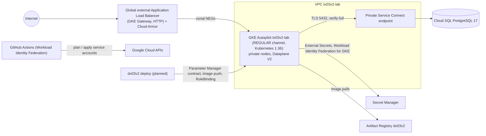

# tx03v2

Google Cloud infrastructure half of a DevOps lab: Terraform, GKE Autopilot, Cloud SQL for PostgreSQL through Private Service Connect, the GKE Gateway with Cloud Armor and GitHub Actions with Workload Identity Federation.

[](https://github.com/maringelix/tx03v2/actions/workflows/ci.yml)

[Português](README.pt-BR.md)

## What is this

A public, educational lab you can clone or fork to learn how a small GKE platform is built, tested
and torn down safely. Everything is checked by a local harness that needs no cloud account; the
cloud path is optional and costs money. **v2 has never been applied to Google Cloud** — the status
matrix below says exactly what is proven and how.

The lab family (v2):

| Repository | Cloud | Role | Status |
|---|---|---|---|
| [`tx01v2`](https://github.com/maringelix/tx01v2) | AWS | infrastructure (Terraform, EKS, RDS, platform layer) | see its status matrix |
| [`dx01v2`](https://github.com/maringelix/dx01v2) | AWS | application | see its status matrix |
| [`tx02v2`](https://github.com/maringelix/tx02v2) | Azure | infrastructure (Terraform, AKS, PostgreSQL, platform layer) | see its status matrix |
| [`dx02v2`](https://github.com/maringelix/dx02v2) | Azure | application | see its status matrix |
| `tx03v2` (this repo) | GCP | infrastructure (Terraform, platform layer) | see status matrix |
| `dx03v2` | GCP | application (sibling of this repo, to be built against `docs/CONTRATO.md`) | `planned` |

Every application repository runs the same app (the dx01v2 message board); only the deploy target
changes, so the comparison between clouds stays fair.

## Status matrix

| Capability | Status | Evidence |
|---|---|---|
| Formatting, validation, provider lock files (4 platforms) | `verified in CI` | `make static` (`terraform-fmt`, `terraform-validate:*`, `terraform-lockfiles`) |
| Lint and IaC security scan (tflint + google ruleset, trivy HIGH/CRITICAL, plain and with the example inputs, no ignores) | `verified in CI` | `make static` (`tflint`, `trivy-config`, `trivy-config-tfvars`, `trivyignore-policy`) |
| Workflows, scripts, platform manifests and Helm values (actionlint, shellcheck, kubeconform, helm template of the External Secrets chart pinned by digest and SHA256) | `verified in CI` | `make static` (`actionlint`, `shellcheck`, `kubeconform`, `helm-template`) |
| Secret scan and repository policies (placeholder identifiers only, pinned actions, the four contract labels, Terraform rules against the v1 regressions) | `verified in CI` | `make static` (`gitleaks`, `policy-*`, `repo-structure`, `version-consistency`) |
| Contract v1 with dx03v2 (15 keys of the Parameter Manager parameter, namespace, deployer RBAC, ClusterSecretStore) | `verified in CI` | `make static` (`contract-parameter`, `contract-platform`); [docs/CONTRATO.md](docs/CONTRATO.md) |
| Terraform unit tests with a mocked google provider (Workload Identity Federation subjects, state bucket, plan and apply roles, IAM condition = lab project roles, budget, GKE Autopilot, network, Cloud SQL, secrets, Artifact Registry, Cloud Armor, contract parameter, IAM grants, negative validations; 60 runs) | `verified in CI` | `make test` |
| Bootstrap (APIs, state bucket, Workload Identity Federation pool and provider, CI service accounts, budget) | `not run in the cloud (v2)` | `terraform/bootstrap`, `docs/RUNBOOK.md` |
| Lab apply (VPC + Cloud NAT, GKE Autopilot on the REGULAR channel, Cloud SQL PostgreSQL 17 through Private Service Connect, Secret Manager, Artifact Registry, Cloud Armor, Parameter Manager contract) | `not run in the cloud (v2)` | `.github/workflows/terraform-apply.yml` |
| Plan on pull requests | `not run in the cloud (v2)` | `.github/workflows/terraform-plan.yml` |
| Platform layer (External Secrets Operator 2.12.0; the GKE Gateway controller is managed by Google) | `not run in the cloud (v2)` | `.github/workflows/platform.yml`, `platform/install.sh` |
| Destroy + leftover check | `not run in the cloud (v2)` | `.github/workflows/terraform-destroy.yml`, `scripts/leftovers.sh` |
| HTTPS on the Gateway | `planned` | outside contract v1 (`docs/CONTRATO.md`) |
| Repository settings as code (ruleset, environment `lab`) | `planned` | `scripts/repo-guardrails.sh`, `docs/PUBLICACAO.md` |

`verified in CI` rows (`HARNESS_STRICT=1 make verify`, 32 checks) run in the CI (`ci.yml`, jobs
`static` and `test`, on every pull request, every push to `main` and weekly) and pass locally in a
Linux container. A cloud row changes only with a `cloud_run_report` issue (date, region, commits,
cost, leftovers).

## Architecture



- `terraform/bootstrap`: the 15 APIs of the lab, the state bucket (versioned, uniform access,
  public access prevention, deletion refused until `state_protection = false`), the Workload
  Identity Federation pool and provider for GitHub, the three CI service accounts with their roles
  (the apply identity can grant at project level only the roles of `modules/project-roles`, through
  an IAM condition) and the monthly budget. Applied once, locally, by the project Owner.
- `terraform/envs/lab`: modules `network`, `gke`, `cloudsql`, `artifact-registry`, `secrets`, `waf`,
  `contract` and `project-roles`, the generated secrets (ephemeral, write-only), every IAM grant of
  the lab (`roles.tf`) and the contract parameter dx03v2 reads.
- `platform/`: the External Secrets Operator chart and the manifests, installed after the apply,
  never by Terraform.
- Design decisions, the AWS / Azure / Google Cloud table and the v1 → v2 table:
  [docs/ARQUITETURA.md](docs/ARQUITETURA.md).

## Quick start (free, local)

You need Docker (devcontainer) or Linux/WSL 2 with bash >= 4.4, curl, unzip, xz, git and make.

```bash
git clone https://github.com/maringelix/tx03v2.git && cd tx03v2
make tools                     # pinned tools into .tools/, SHA256-verified
HARNESS_STRICT=1 make verify   # every static check + terraform test
make help
```

On Windows or macOS, open the folder in the devcontainer (`.devcontainer/devcontainer.json`); it
runs `make tools` for you. Nothing here touches Google Cloud.

## Cloud path (costs money)

**Cost first:** about US$0.12 per hour in us-central1 with the defaults while the GKE free tier
covers the cluster fee (US$74.40 per month per billing account, enough for one Autopilot or zonal
cluster), about US$0.22 per hour without it. The biggest items are the GKE cluster fee (when the free
tier is already used elsewhere), Cloud SQL and the load balancer. A 3-hour round costs about
US$0.40-0.70 plus data; a forgotten lab costs about US$90-160 per month. These are estimates from the
list prices read on 2026-10-11, not verified on a bill, and your billing account may use another
currency: see [docs/CUSTOS.md](docs/CUSTOS.md). Use a dedicated project, keep the budget alerts (a
budget never stops spending) and destroy on the same day.

Follow [docs/RUNBOOK.md](docs/RUNBOOK.md): bootstrap → GitHub variables of tx03v2 (and of dx03v2) →
apply → platform → deploy dx03v2 (`planned`) → smoke test → destroy → leftover check (locally, as the
project Owner) → `cloud_run_report` issue.

## Harness

| Target | What it runs | When |
|---|---|---|
| `make help` | lists the targets | any time |
| `make tools` | `scripts/install-tools.sh`: terraform 1.16.5, tflint 0.64.0 + google ruleset 0.40.0, trivy 0.75.0, actionlint 1.7.12, shellcheck 0.11.0, kubeconform 0.8.0, gitleaks 8.30.1, kubectl 1.37.1, helm 4.3.0 | once, and after a tool bump |
| `make static` | `scripts/harness.sh static` | before every push |
| `make test` | `scripts/harness.sh test` (`terraform test`, mocked google provider) | before every push |
| `make verify` | static + test (what CI runs) | before every PR |
| `make all` | every stage (same as verify here) | — |
| `make clean` | removes `.tools/`, caches and Terraform working dirs | — |

`scripts/harness.sh list` prints every check. The `platform` and `terraform-destroy` workflows install
the Google Cloud CLI 588.0.0 with `google-github-actions/setup-gcloud`; you need your own gcloud only
for the cloud path.
Details: [docs/HARNESS.md](docs/HARNESS.md).

## Docs

All docs are in Brazilian Portuguese.

| Doc | Content |
|---|---|
| [docs/ARQUITETURA.md](docs/ARQUITETURA.md) | diagram, ADRs, AWS / Azure / Google Cloud, v1 → v2 |
| [docs/CONTRATO.md](docs/CONTRATO.md) | tx03v2 ⇄ dx03v2 contract v1 (source of truth) |
| [docs/RUNBOOK.md](docs/RUNBOOK.md) | full cloud round |
| [docs/CUSTOS.md](docs/CUSTOS.md) | cost estimate per component, with and without the GKE free tier |
| [docs/GUARDRAILS.md](docs/GUARDRAILS.md) | rules, enforcement, exceptions, limits |
| [docs/HARNESS.md](docs/HARNESS.md) | checks, strict mode, troubleshooting |
| [docs/SUSTENTACAO.md](docs/SUSTENTACAO.md) | routines, end-of-support calendar, update procedures |
| [docs/PUBLICACAO.md](docs/PUBLICACAO.md) | checklist to make the repository public |
| [docs/LICOES_APRENDIDAS.md](docs/LICOES_APRENDIDAS.md) | lessons learned from the GCP v1 lab |

## Contributing

Read [CONTRIBUTING.md](CONTRIBUTING.md) and [AGENTS.md](AGENTS.md) (also for humans). Security
issues: [SECURITY.md](SECURITY.md).

## License

[MIT](LICENSE) — Copyright (c) 2025-2026 Bruno Maringeli.
