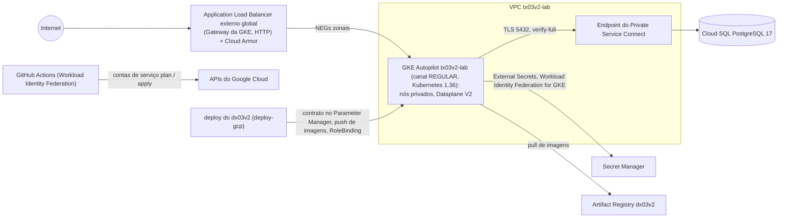

# tx03v2

Metade de infraestrutura Google Cloud de um lab de DevOps: Terraform, GKE Autopilot, Cloud SQL para PostgreSQL por Private Service Connect, o Gateway da GKE com Cloud Armor e GitHub Actions com Workload Identity Federation.

[](https://github.com/maringelix/tx03v2/actions/workflows/ci.yml)

[English](README.md)

**Fork do lab:** o [FORK.md](FORK.md) (em inglês) leva você do fork ao lab rodando, primeiro na sua máquina, depois na sua conta de nuvem.

## O que é

Um lab público e educacional para clonar ou fazer fork e aprender como uma plataforma GKE pequena é
construída, testada e destruída com segurança. Tudo é verificado por um harness local que não precisa
de conta na nuvem; o caminho em nuvem é opcional e custa dinheiro. **A v2 nunca foi aplicada no
Google Cloud** — a matriz de status abaixo diz exatamente o que está provado e como.

A família do lab (v2):

| Repositório | Nuvem | Papel | Status |
|---|---|---|---|
| [`tx01v2`](https://github.com/maringelix/tx01v2) | AWS | infraestrutura (Terraform, EKS, RDS, camada de plataforma) | veja a matriz de status dele |
| [`dx01v2`](https://github.com/maringelix/dx01v2) | AWS | aplicação | veja a matriz de status dele |
| [`tx02v2`](https://github.com/maringelix/tx02v2) | Azure | infraestrutura (Terraform, AKS, PostgreSQL, camada de plataforma) | veja a matriz de status dele |
| [`dx02v2`](https://github.com/maringelix/dx02v2) | Azure | aplicação | veja a matriz de status dele |
| `tx03v2` (este repositório) | GCP | infraestrutura (Terraform, camada de plataforma) | ver matriz de status |
| [`dx03v2`](https://github.com/maringelix/dx03v2) | GCP | aplicação (par deste repositório, construída sobre o `docs/CONTRATO.md`) | veja a matriz de status dele |

Todo repositório de aplicação roda o mesmo app (o mural de mensagens do dx01v2); só o destino do
deploy muda, para que a comparação entre as nuvens seja justa.

## Matriz de status

| Capacidade | Status | Evidência |
|---|---|---|
| Formatação, validação, lock files de providers (4 plataformas) | `verificado no CI` | `make static` (`terraform-fmt`, `terraform-validate:*`, `terraform-lockfiles`) |
| Lint e scan de segurança da IaC (tflint + ruleset google, trivy HIGH/CRITICAL, simples e com as entradas de exemplo, sem ignores) | `verificado no CI` | `make static` (`tflint`, `trivy-config`, `trivy-config-tfvars`, `trivyignore-policy`) |
| Workflows, scripts, manifests da plataforma e values do Helm (actionlint, shellcheck, kubeconform, helm template do chart do External Secrets fixado por digest e SHA256) | `verificado no CI` | `make static` (`actionlint`, `shellcheck`, `kubeconform`, `helm-template`) |
| Scan de segredos e políticas do repositório (só identificadores placeholder, actions fixadas, os quatro labels do contrato, regras de Terraform contra as regressões do v1) | `verificado no CI` | `make static` (`gitleaks`, `policy-*`, `repo-structure`, `version-consistency`) |
| Contrato v1 com o dx03v2 (15 chaves do parâmetro do Parameter Manager, namespace, RBAC do deployer, ClusterSecretStore) | `verificado no CI` | `make static` (`contract-parameter`, `contract-platform`); [docs/CONTRATO.md](docs/CONTRATO.md) |
| Testes unitários do Terraform com provider google mockado (sujeitos do Workload Identity Federation, bucket do state, papéis do plan e do apply, condição IAM = papéis de projeto do lab, budget, GKE Autopilot, rede, Cloud SQL, segredos, Artifact Registry, Cloud Armor, parâmetro do contrato, concessões IAM, validações negativas; 63 casos) | `verificado no CI` | `make test` |
| Bootstrap (APIs, bucket do state, pool e provider do Workload Identity Federation, contas de serviço do CI, budget) | `não executado em nuvem (v2)` | `terraform/bootstrap`, `docs/RUNBOOK.md` |
| Apply do lab (VPC + Cloud NAT, GKE Autopilot no canal REGULAR, Cloud SQL PostgreSQL 17 por Private Service Connect, Secret Manager, Artifact Registry, Cloud Armor, contrato no Parameter Manager) | `não executado em nuvem (v2)` | `.github/workflows/terraform-apply.yml` |
| Plan em pull requests | `não executado em nuvem (v2)` | `.github/workflows/terraform-plan.yml` |
| Camada de plataforma (External Secrets Operator 2.12.0; o controlador de Gateway da GKE é gerenciado pelo Google) | `não executado em nuvem (v2)` | `.github/workflows/platform.yml`, `platform/install.sh` |
| Destroy + checagem de sobras | `não executado em nuvem (v2)` | `.github/workflows/terraform-destroy.yml`, `scripts/leftovers.sh` |
| HTTPS no Gateway | `planejado` | fora do contrato v1 (`docs/CONTRATO.md`) |
| Configurações do repositório como código (ruleset, environment `lab`) | `verificado localmente` | `scripts/repo-guardrails.sh` aplicado; conferido com `gh api` em 2026-10-13 (`docs/PUBLICACAO.md`) |
| **Lab local, checks estáticos**: testes de plan do `terraform/envs/local` (rede privada, labels, registry só em loopback, banco só TLS, digests, validações negativas; 10 casos), 15 charts locais por SHA256 renderizando só digests e ClusterIP, políticas do Gatekeeper contra os casos do gator | `verificado localmente` | `terraform-test:envs/local`, `helm-template-local`, `kubeconform-local`, `policy-gator`, `local-versions` |
| **Lab local** (Terraform no Docker): cluster kind + Artifact Registry, Cloud SQL (PostgreSQL, só TLS), Cloud Storage (emulador com API S3), load balancer e servidor git emulados; destroy + checagem de sobras | `verificado no CI` | `make e2e` (`terraform/envs/local`, `scripts/local-lab.sh`) |
| Service mesh: Istio 1.31 ambient, mTLS `STRICT`, `AuthorizationPolicy` por identidade | `verificado no CI` | `make e2e` (`platform/local/check.sh`: sondas permitida, de outra identidade e em texto puro) |
| Gateway API no Istio atrás do load balancer emulado, HTTPS com cert-manager (CA do lab), HTTP → HTTPS | `verificado no CI` | `make e2e` |
| External Secrets (ClusterSecretStore `local-secrets`), metrics-server | `verificado no CI` | `make e2e` |
| Observabilidade: Prometheus, Alertmanager (alerta sintético entregue), Grafana (ClusterIP), Loki + Alloy | `verificado no CI` | `make e2e` |
| GitOps com Argo CD 3.5 (commit → sync → self-heal a partir do servidor git do lab) | `verificado no CI` | `make e2e` |
| Policy as code no cluster: Gatekeeper 3.23 em `deny` (registries permitidos, imagens fixadas, recursos, probes, labels, NodePort) | `verificado no CI` | `make e2e` |
| Scan dentro do cluster: Trivy Operator (relatórios de vulnerabilidade e de configuração) | `verificado no CI` | `make e2e` |
| Ensaio de backup e restore: Velero no emulador de objetos (namespace apagado e restaurado com os dados) | `verificado no CI` | `make e2e` |
| Chaos engineering com hipótese: pod-kill do Chaos Mesh, disponibilidade medida | `verificado no CI` | `make e2e` |
| Os mesmos add-ons na GKE | `planejado` | o lab local mostra o alvo; a camada de plataforma em nuvem instala só o ESO (vários desses add-ons precisam de privilégios que o Autopilot recusa, `docs/LAB_LOCAL.md`) |

As linhas `verificado no CI` (`HARNESS_STRICT=1 make verify`) rodam no CI (`ci.yml`, jobs `static`
e `test`, em todo pull request, em todo push para a `main` e toda semana) e passam localmente num
container Linux. Uma linha de nuvem só muda com uma issue `cloud_run_report` (data, região, commits,
custo, sobras). As linhas do lab local vão rodar também no job `e2e` do CI.

## Arquitetura



- `terraform/bootstrap`: as 15 APIs do lab, o bucket do state (versionado, acesso uniforme,
  prevenção de acesso público, exclusão recusada até `state_protection = false`), o pool e o
  provider do Workload Identity Federation para o GitHub, as três contas de serviço do CI com seus
  papéis (o apply só consegue conceder no projeto os papéis de `modules/project-roles`, por uma
  condição IAM) e o budget mensal. Aplicado uma vez, localmente, pelo Owner do projeto.
- `terraform/envs/lab`: módulos `network`, `gke`, `cloudsql`, `artifact-registry`, `secrets`, `waf`,
  `contract` e `project-roles`, os segredos gerados (ephemeral, write-only), todas as concessões IAM
  do lab (`roles.tf`) e o parâmetro do contrato que o dx03v2 lê.
- `platform/`: o chart do External Secrets Operator e os manifests, instalados depois do apply, nunca
  pelo Terraform.
- Decisões de design, a tabela AWS / Azure / Google Cloud e a tabela v1 → v2:
  [docs/ARQUITETURA.md](docs/ARQUITETURA.md).

## Início rápido (grátis, local)

Você precisa de Docker (devcontainer) ou Linux/WSL 2 com bash >= 4.4, curl, unzip, xz, git e make.

```bash
git clone https://github.com/maringelix/tx03v2.git && cd tx03v2
make tools                     # ferramentas fixadas em .tools/, SHA256 conferido
HARNESS_STRICT=1 make verify   # todos os checks estáticos + terraform test
make help
```

No Windows ou macOS, abra a pasta no devcontainer (`.devcontainer/devcontainer.json`); ele roda
`make tools` sozinho. Nada aqui toca o Google Cloud.

### O lab inteiro na sua máquina (grátis)

O lab v1 rodava a plataforma (mesh, monitoração, GitOps, políticas, scan, backup, chaos) só na nuvem,
e no Autopilot boa parte foi recusada. O lab local monta a mesma plataforma no Docker, para estudar e
quebrar sem conta (status acima: a rodada de ponta a ponta está `verificado no CI`):

```bash
make e2e            # up + todas as sondas + down: 30 a 40 minutos no tx01v2, 8 GB de memória no Docker para "full"
make local-up       # ou deixe rodando (LOCAL_PROFILE=core|observability|operations|full)
make local-check    # sondas contra o lab rodando
make local-down     # destroy + checagem de sobras
```

| Google Cloud (caminho em nuvem) | Lab local |
|---|---|
| GKE Autopilot 1.36 (canal REGULAR) | kind 1.36 (`terraform/envs/local`) |
| Artifact Registry | registry (`registry.tx03v2.local`, push em `localhost:5003`) |
| Cloud SQL for PostgreSQL 17 (Private Service Connect, CA compartilhada, `verify-full`) | PostgreSQL 17, só TLS, CA do lab |
| Gateway da GKE (Application Load Balancer externo global) + Cloud Armor | cloud-provider-kind + Gateway do Istio (Gateway API); sem WAF |
| Certificado do listener HTTPS (`planejado` no Gateway da GKE) | cert-manager, ClusterIssuer `lab-ca` |
| Secret Manager + ESO (Workload Identity Federation for GKE) | Secrets de `lab-secrets` + ESO |
| Cloud Storage (backups) | Versity S3 Gateway (API S3) |
| Contrato no Parameter Manager | ConfigMap `lab-system/lab-contract` (`docs/CONTRATO.md`) |
| GitHub (origem do GitOps) | servidor git Soft Serve |

Detalhes, sondas e limites: [docs/LAB_LOCAL.md](docs/LAB_LOCAL.md) e
[docs/ARQUITETURA.md](docs/ARQUITETURA.md). O deploy do dx03v2 em cima dele (pelo contrato local) está
`planejado` no dx03v2.

## Caminho em nuvem (custa dinheiro)

**Custo primeiro:** cerca de US$0,12 por hora em us-central1 com os padrões enquanto o free tier da
GKE cobre a taxa do cluster (US$74,40 por mês por conta de faturamento, o bastante para um cluster
Autopilot ou zonal), cerca de US$0,22 por hora sem ele. Os maiores itens são a taxa do cluster GKE
(quando o free tier já é usado por outro cluster), o Cloud SQL e o load balancer. Uma rodada de 3
horas custa cerca de US$0,40-0,70 mais dados; um lab esquecido custa cerca de US$90-160 por mês. São
estimativas a partir dos preços de tabela lidos em 2026-10-11, não verificadas numa fatura, e a sua
conta de faturamento pode usar outra moeda: veja o [docs/CUSTOS.md](docs/CUSTOS.md). Use um projeto
dedicado, mantenha os alertas do budget (um budget nunca para os gastos) e destrua no mesmo dia.

Siga o [docs/RUNBOOK.md](docs/RUNBOOK.md): bootstrap → variáveis do GitHub do tx03v2 (e do dx03v2) →
apply → plataforma → deploy do dx03v2 (workflow `deploy-gcp` de lá) → smoke test → destroy → checagem de sobras
(local, como Owner do projeto) → issue `cloud_run_report`.

## Harness

| Alvo | O que roda | Quando |
|---|---|---|
| `make help` | lista os alvos | a qualquer momento |
| `make tools` | `scripts/install-tools.sh`: terraform 1.16.5, tflint 0.64.0 + ruleset google 0.40.0, trivy 0.75.0, actionlint 1.7.12, shellcheck 0.11.0, kubeconform 0.8.0, gitleaks 8.30.1, kubectl 1.37.1, helm 4.3.0, kind 0.33.0, gator 3.23.1 | uma vez, e depois de atualizar uma ferramenta |
| `make static` | `scripts/harness.sh static` | antes de cada push |
| `make test` | `scripts/harness.sh test` (`terraform test`, providers mockados) | antes de cada push |
| `make verify` | static + test (jobs `static` e `test` do CI) | antes de cada PR |
| `make e2e` | `scripts/harness.sh e2e`: o lab local de ponta a ponta (job `e2e` do CI) | mudanças na plataforma ou no lab local |
| `make all` | static + test + e2e | — |
| `make clean` | remove `.tools/`, caches e diretórios de trabalho do Terraform | — |

`scripts/harness.sh list` mostra todos os checks. Os workflows `platform` e `terraform-destroy`
instalam o Google Cloud CLI 588.0.0 com `google-github-actions/setup-gcloud`; você só precisa do seu
próprio gcloud para o caminho em nuvem. Detalhes: [docs/HARNESS.md](docs/HARNESS.md).

## Documentação

| Documento | Conteúdo |
|---|---|
| [FORK.md](FORK.md) | fork do lab (em inglês): o que o GitHub não copia, o lab local, a sua conta de nuvem |
| [docs/ARQUITETURA.md](docs/ARQUITETURA.md) | diagrama, ADRs, AWS / Azure / Google Cloud, v1 → v2 |
| [docs/CONTRATO.md](docs/CONTRATO.md) | contrato tx03v2 ⇄ dx03v2 v1 (fonte da verdade) |
| [docs/RUNBOOK.md](docs/RUNBOOK.md) | rodada completa na nuvem |
| [docs/LAB_LOCAL.md](docs/LAB_LOCAL.md) | o lab local: o que é emulado, como rodar, sondas, limites |
| [docs/CUSTOS.md](docs/CUSTOS.md) | estimativa de custo por componente, com e sem o free tier da GKE |
| [docs/GUARDRAILS.md](docs/GUARDRAILS.md) | regras, aplicação, exceções, limites |
| [docs/HARNESS.md](docs/HARNESS.md) | checks, modo estrito, problemas comuns |
| [docs/SUSTENTACAO.md](docs/SUSTENTACAO.md) | rotinas, calendário de fim de suporte, procedimentos de atualização |
| [docs/PUBLICACAO.md](docs/PUBLICACAO.md) | checklist para tornar o repositório público |
| [docs/LICOES_APRENDIDAS.md](docs/LICOES_APRENDIDAS.md) | lições aprendidas com o lab GCP v1 |

## Contribuindo

Leia o [CONTRIBUTING.md](CONTRIBUTING.md) e o [AGENTS.md](AGENTS.md) (também para humanos).
Vulnerabilidades: [SECURITY.md](SECURITY.md).

## Licença

[MIT](LICENSE) — Copyright (c) 2025-2026 Bruno Maringeli.
