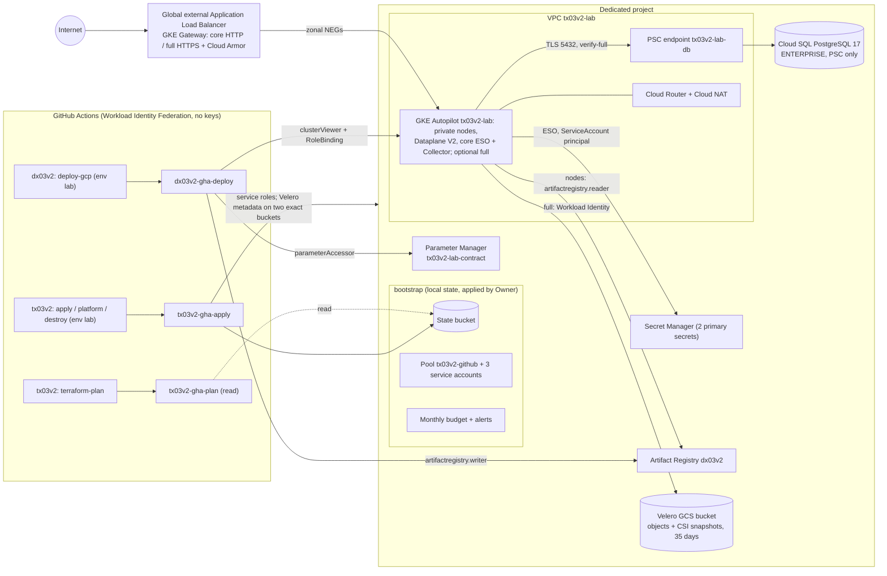
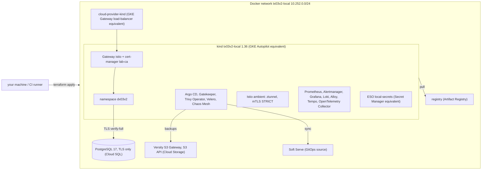

# tx03v2 architecture

> Decision and lesson tables preserve the initial state of each round. Current
> HA/backup/PITR/DR scope is in [CONTINUITY.md](CONTINUITY.md); capacity,
> OpenCost/VPA/Spot and estimates are in [FINOPS.md](FINOPS.md). Older decisions
> marked out of scope do not revoke subsequent R7–R10 construction.

Google Cloud lab infrastructure, its short architecture decision records,
equivalence to AWS (`tx01v2`)/Azure (`tx02v2`) and changes from v1. None has been
applied in the cloud in v2 (`not run in the cloud (v2)`); cited tests/checks cover
configuration, not managed-service execution.

## Diagram

Layers: `terraform/bootstrap` (once, by a human project Owner) →
`terraform/envs/lab` (modules `network`, `gke`, `cloudsql`, `artifact-registry`,
`secrets`, `waf`, `contract`, `project-roles`, `velero`) → `platform/` (Helm and
manifests, never through Terraform) → dx03v2 app through GitOps revision
`gitops/gcp` in `full` (R4.4). `docs/CONTRACT.md` defines the interfaces. No cloud
run has occurred.

## Local lab

The same architecture emulated in Docker (`terraform/envs/local` +
`platform/local`) with the complete v1 platform: tx01v2's local lab adapted to
tx03v2 names and Google Cloud equivalents. Details, probes and limits:
`docs/LOCAL_LAB.md` (complete run in CI `e2e`).

## Decisions (short ADRs)

| # | Decision | Reason | Rejected alternative |
| --- | --- | --- | --- |
| 1 | GKE Autopilot instead of Standard | no node pools to size, pod-request billing, GKE USD74.40/month billing-account credit covers one Autopilot cluster fee, Dataplane V2 enforces DX NetworkPolicies; harness rejects `google_container_node_pool` | Standard node pool (VM sizing; regional Standard cluster excluded from credit) |
| 2 | Dedicated project per lab | budget, leftovers and CI roles are project-scoped; nothing above project (organization/folder resources rejected); project deletion is strongest final cleanup | project shared with other systems |
| 3 | Private Service Connect instead of private services access | private-services-access peering cannot be deleted after a Cloud SQL instance existed (terraform-provider-google #19908, open since 2024-10, still reported 2026-07); destroy would fail. PSC uses an internal address/forwarding rule without peering; only lab project consumes it | v1 private-services-access /16 peering; authorized-network public IP |
| 4 | Shared CA (`GOOGLE_MANAGED_CAS_CA`) and PSC DNS | instance DNS SAN enables DX `verify-full` with regional public bundle rooted only at contract CA; private `<region>.sql.goog.` zone resolves to endpoint; automatic maintenance certificate rotation | per-instance CA (`GOOGLE_MANAGED_INTERNAL_CA`, changes each instance); unverified TLS in v1 |
| 5 | Parameter Manager contract store | global JSON `tx03v2-lab-contract`, one live `c-<sha256[0:16]>` version, `create_before_destroy`; render needs only parameterAccessor. Provider8.6.0 has no per-parameter IAM, hence project grant in dedicated project | shared remote state (exposes entire state); parameter per key |
| 6 | ESO controller ServiceAccount directly as GKE WIF principal | no Google service account/key: secretAccessor per secret for `principal://.../subject/ns/external-secrets/sa/external-secrets`; ClusterSecretStore has no auth block | Google service account annotation `iam.gke.io/gcp-service-account`; JSON key Secret |
| 7 | IAM-only DNS control-plane endpoint | hosted runners/laptops lack fixed IP; every `*.gke.goog` request passes IAM `container.clusters.connect`, then RBAC; Kubernetes tokens/certificates disabled there; IP endpoint private, authorized networks contain no CIDR or Google public IP (CIS GKE5.6.3) | `0.0.0.0/0` public endpoint (DX02 counterpart's ADR19); bastion/VPN |
| 8 | Cloud Armor Standard, 64 KB inspection | seven CRS3.3 categories `sqli`, `xss`, `lfi`, `rfi`, `rce`, `methodenforcement`, `scannerdetection`, sensitivity1/deny403; 600 requests/minute/IP exceeds contract300 for smoke. L7 Adaptive Protection alerts only (no Standard signatures/automatic mitigation), default allow, standard JSON parsing. 64 KB maximum, no oversize block; API returns413 for smoke70 KB. WAF disabled publishes none | Enterprise subscription; no WAF (optional, ~USD0.011/h cheaper) |
| 9 | GA `hashicorp/google` only | harness rejects google-beta; every used feature exists in8.6.0 GA, schema inspected | beta attributes changing without notice |
| 10 | Owner-applied bootstrap with local state | enables APIs, creates state bucket/CI identities before CI can act; one executor per root (v1lesson25); back up terraform.tfstate or deliberately migrate to bucket | CI bootstrap with Owner credential |
| 11 | No Kubernetes/Helm Terraform providers | state independent of cluster API; destroy not blocked on Kubernetes objects; separate layers | Terraform-managed Helm |
| 12 | Ephemeral secrets and write-only `password_wo`/`secret_data_wo` | DB password/admin token absent from plan/state; same apply sends same password to SQL/secret; db_password_version rotates both | state-persisted random_password resource |
| 13 | GitHub WIF with one exact immutable subject per binding | provider condition fixes numeric repository_owner_id/repository_id; deleted/reclaimed names cannot inherit. workloadIdentityUser subjects `repo:<owner>@<id>/<repo>@<id>:` with pull_request/main/environment:lab; harness rejects service-account keys/credentials_json | GitHub JSON-key secret; owner/repository principalSet (v1) |
| 14 | Apply projectIamAdmin conditioned by modifiedGrantsByRole | `api.getAttribute('iam.googleapis.com/modifiedGrantsByRole', []).hasOnly([...])` permits exactly the four module project-roles roles (original list had three before tracing). Syntax checked against "Delegate granting access with IAM conditions", 2026-10-11; both roots have preconditions/tests; apply cannot grant itself Owner | unconditional projectIamAdmin (v1) |
| 15 | Apply service admins only for lab services | artifactregistry/cloudsql/compute.networkAdmin/compute.securityAdmin/container/dns/parametermanager, browser/serviceUsageConsumer, custom tx03v2LabSecrets, serviceAccountUser only on bootstrap-created tx03v2-lab-nodes, state-bucket objectUser. Replaced Editor (VMs/buckets/BigQuery/PubSub/KMS/state access), Secret Manager Admin (all values), project-wide serviceAccountUser (any identity). Custom secret role creates/grants/versions without general value access; protected continuity sync separately reads four exact secrets. Node identity exists before apply, avoiding GCP-0011. Service roles remain project-wide: resource-name conditions cannot generally authorize creation of a nonexistent resource; secret-creation failure has been reported and network/DB support was not cloud-verified. Dedicated project/preflight remains mandatory. After a real PERMISSION_DENIED, bootstrap operator may deliberately add apply_extra_project_roles | Editor plus admins beforeR3.16; Owner |
| 16 | Plan Viewer, Security Reviewer, Parameter Viewer; state objectViewer; `-lock=false` | refresh reads resources/IAM-member policies and parameter version payload (parameterVersions.get, google8.6.0). Secret versions use secret_data_wo_version, never access; read-only bucket cannot create lock | plan Editor |
| 17 | Bootstrap creates tx03v2-lab-nodes | container.defaultNodeServiceAccount for logs/metrics/metadata; registry reader only on dx03v2 granted by lab root; never default Compute Engine Editor identity. Preexistence permits narrow serviceAccountUser (ADR15); survives rounds like CI identities | default identity; lab-root-created account requiring project-wide impersonation |
| 18 | Managed GKE Gateway with reserved global address | gke-l7-global-external-managed, NamedAddress tx03v2-lab-gateway, no controller install/pin, one ingress (v1lesson3); core HTTP80, full optional HTTPS (ADR46) | v1Ingress/ManagedCertificate; ingress-nginx |
| 19 | Uninstall before destroy | delete dx03v2, wait Gateway finalizer/NEGs. Controller creates forwarding rules/proxies/URL map/backends/health checks/NEGs outside state; cluster-first deletion leaks (v1lesson4). End with leftovers retry900; destroy.sh removes lab API resources if uninstall fails | terraform destroy alone |
| 20 | PostgreSQL 17 ENTERPRISE db-g1-small, zonal10 GB/no autoresize, 1backup/no PITR in core | PostgreSQL 16+ defaults Enterprise Plus but shared-core exists only in Enterprise (lesson12);50 connections cover4×pool10 plus migration; reject f1-micro25 connections/Plus tiers | v1Plus db-perf-optimized-N-2 ~USD150/month; f1-micro |
| 21 | Random two-byte SQL suffix; app DB/user ABANDON | deleted instance name reserved up to a week; PostgreSQL cannot delete object-owning user, both disappear with instance (provider#7677) | fixed name, v1partial creation outside state |
| 22 | State suffix `substr(sha1(project_id), 0, 8)` | predictable TF_STATE_BUCKET validated by workflows, no bootstrap randomness | random suffix |
| 23 | State uniform access/public prevention/versioning, old versions30 days, force_destroy=false, deletion_policy=PREVENT until state_protection=false, Google encryption | state survives rounds; GCS object lock; no workflow deletes state/lock | variable-inflexible prevent_destroy; billed KMS CMEK/IAM |
| 24 | Immutable dx03v2 Artifact Registry; delete untagged >7 days, retain10latest, scanning disabled | one publication per SHA; DX CI Trivy gate instead of billed Artifact Analysis | mutable latest in v1 |
| 25 | Provider default_labels per root, add_terraform_attribution_label=false | exactly four labels on capable resources (policy-labels); modules never configure provider | duplicated resource labels |
| 26 | Private Google Access plus AUTO_ONLY NAT for node subnet, error-only logs | private nodes reach Google APIs without NAT, other Internet via NAT; logs billed perGB | public node IPs |
| 27 | SYSTEM_COMPONENTS/WORKLOADS GKE logs; core without in-cluster observability, full Prometheus/Alertmanager/Grafana/Loki/Alloy/Tempo | inexpensive default; full adds local-lab observability probes, requests in COSTS (R4.2/R4.7) | stack in every profile |
| 28 | Bootstrap budget without currency_code | billing-account currency;50/90/100% actual and100% forecast alerts to billing admins/optional emails; alerts only | v1documentation-only budget |
| 29 | Cluster/instance deletion protection false by default | destroy ends every disposable lab round; optional DB protection documented separately | protection requiring prior apply |
| 30 | Terraform Docker provider and CLI kind through terraform_data/local-exec | cloud-like apply/destroy without account; tehcyx/kind embeds old kind; disposable machine credentials in local random_password/local backend only | gcloud emulators cover PubSub/Datastore/Firestore/Bigtable/Spanner, not GKE/Cloud SQL/Secret Manager; minikube |
| 31 | Local Istio ambient | identity authorization/mTLS without sidecars; kind supports it (v1Autopilot rejected sidecar/ztunnel NET_ADMIN, lesson7) | sidecar memory cost; Linkerd |
| 32 | Argo CD reads local Git server | sole app-namespace owner; state key for push, anonymous read; ClusterIP only | Flux; GitHub credentials/Internet on deployment path |
| 33 | Own Gatekeeper policies with gator tests | v1tx01/tx03latest rules in deny, acceptance/rejection cases | full gatekeeper-library; unevaluated GKEPolicyController; Kyverno as sole policy engine |
| 34 | Alertmanager to in-cluster alert-sink, optional Slack Secret webhook | delivery proof without external credential; absent webhook sends Slack-shaped message to sink for assertion | v1webhook in tracked values |
| 35 | Local S3 Velero, cloud full GCP plugin/GCS with objects and CSI volumes (R9) | KSA velero/velero directly gets bucket-only objectAdmin via WIF;35daySchedule, PD CSI snapshots, force_destroy=false. Cloud SQL native backups separate; multiregion/restore in R9 | JSON-key Secret; project-wide object role; pg_dump as replacement for Kubernetes backups |
| 36 | Local core/observability/operations/full;10.252.0.0/24, localhost:5003 | small machines validate layers separately, CI full; distinct from AWS10.250.0.0/24:5001 and Azure10.251.0.0/24:5002 | one profile; colliding addresses |
| 37 | OTLP Collector to Cloud Trace core, Cloud Trace+Tempo full; observability/opentelemetry-collector principal/cloudtrace.agent | app backend-independent; full adds Tempo/spanmetrics without removing Cloud Trace; R8persistentTempo (ADR49) | Cloud Trace SDK in app; key |
| 38 | R4.2 in-cluster full observability; managed Cloud Monitoring/Logging/Trace documented alternative | local renders already cover metrics, rule/Alertmanager delivery, logs, traces/spanmetrics and Grafana correlation; managed equivalent has separate ingestion/query evidence and cost in COSTS | presenting a managed backend as proof of Loki/Tempo/Grafana |
| 39 | R4.6 exclude upstream ambient from GCP | GKE ambient support requires explicit GKE approval/feature enablement; lab has neither and excludes upstream istio-cni/ztunnel. Checked2026-10-16: [GKE ambient](https://docs.cloud.google.com/kubernetes-engine/docs/how-to/prepare-ambient-networking), [Autopilot security](https://docs.cloud.google.com/kubernetes-engine/docs/concepts/autopilot-security) | assuming ambient or installing unapproved node components |
| 40 | R4.6 Gatekeeper exempts only internal/controller namespaces | kube-system, kube-public, kube-node-lease, gke-system, gke-managed-system, cert-manager, external-secrets, monitoring, observability, argocd, gatekeeper-system, trivy-system, velero, chaos-mesh; application dx03v2 remains covered | provider-wide/app exemptions |
| 41 | R4.6 keep Chaos Mesh controller, omit chaos-daemon; cloud PodChaos pod-kill only, mesh latency (ADR51) | chart2.8.4 cannot disable daemon by values; Helm4 postrenderer removes only that object. Autopilot blocks most privileged workloads; PodChaos pod-kill uses Kubernetes API, network/time/filesystem/container/stress/node operations need daemon. Checked2026-10-16 [Autopilot security](https://docs.cloud.google.com/kubernetes-engine/docs/concepts/autopilot-security), [PodChaos](https://chaos-mesh.org/docs/simulate-pod-chaos-on-kubernetes/), [chart2.8.4](https://github.com/chaos-mesh/chaos-mesh/blob/v2.8.4/helm/chaos-mesh/README.md) | privileged DaemonSet or promises of daemon-based experiments |
| 42 | R4.7 reproducible full chart-request sum, core default | platform-sizing renders pins, multiplies replicas and counts Prometheus/Alertmanager. GCP2026-10-17 with R8Kyverno:1360mCPU/3856 MiB including ESO;2026-10-16 beforeKyverno:840m/3280 MiB. Autopilot manages/bills capacity by requests, no node_instance_types/node_desired_size. Rates/total in COSTS; [GKEpricing](https://cloud.google.com/kubernetes-engine/pricing) | unsourced number; pretending Autopilot exposes node-pool sizing |
| 43 | R4.6/R8.4 Trivy without local mirror; registry read as ServiceAccount principal | node collector disabled; scans use trivy-system/trivy-operator WIF/reader on dx03v2 only (R8), short-lived token, no key/pull Secret. Missing report means scan did not run | claiming private-image coverage without identity; key |
| 44 | R4.4 Argo sync restricted to identified contract operators | Application RoleBinding uses User service-account/member emails; no Google Groups RBAC. GKE needs Workspace security group/cluster configuration. Checked2026-10-16 [GKERBAC](https://docs.cloud.google.com/kubernetes-engine/docs/how-to/google-groups-rbac) | unmapped Kubernetes group |
| 45 | R4.5 Velero metadata only on exact owned buckets | `tx03v2VeleroBucket` condition uses bucket `resource.type` and exact names `tx03v2-lab-velero-<project_id>` and `tx03v2-lab-dr-velero-<project_id>`. Creation and get/update/delete/getIamPolicy/setIamPolicy are constrained by type/name; no object permission. [Storage conditions](https://docs.cloud.google.com/storage/docs/access-control/iam?hl=en), [IAM attributes](https://docs.cloud.google.com/iam/docs/conditions-resource-attributes). Configuration tested; cloud unrun | project-wide bucket metadata or Terraform object access |
| 46 | R8.1 optional DNS/HTTPS via Cloud DNS/Certificate Manager | dns_zone_name/app_domain_name create public zone, Gateway A, DNSauthorization CNAME, managed cert/CertificateMap annotation and Google renewal; HTTP80redirect. Fork owner delegates output dns_name_servers; without delegation certificate stays PROVISIONING and full installer refuses. No embedded domain/zone. GCP edge uses Certificate Manager, not cert-manager/ACME Kubernetes Secret (local AWS twin proves ACME) | Let'sEncrypt Secret (external-global GKEGateway cannot read it); v1ManagedCertificate without map |
| 47 | R8.2 managed Cloud Service Mesh on Autopilot | no privileged istio-cni/ztunnel (ADR39); official membership/servicemesh MANAGEMENT_AUTOMATIC and managed sidecars, istio-injection:enabled/mesh.cloud.google.com/proxy namespace annotation, REGULAR control-plane/update channel. Compared to AWS/Azure: sidecars cost more per-pod requests, no waypoint, L7 VirtualService/DestinationRule, trust <project>.svc.id.goog. App namespace only; monitoring/observability outside so Prometheus hooks finish and core Collector unchanged. Their plaintext app access is narrowly limited by port/path in app-security.yaml. Managed price unconfirmed, COSTS | upstream ambient/NET_ADMIN sidecar; mesh in every namespace |
| 48 | R8.1/R8.4 namespace STRICT mTLS, workload/port exceptions | portLevelMtls needs workload selector; namespace default STRICT, separate plaintext policies web8080/API3000 for LB, API9464 for Prometheus. Identity between app workloads, two LB source ranges at edges; Collector probe only /healthz, /readyz | namespace-wide plaintext or full pod-range allow |
| 49 | R8.3 persistent full observability | Prometheus7 days/8 GB, Alertmanager72h, Grafana, Loki7 days, Tempo72h on standard-rwo PVCs (R4emptyDir lost restarts); app recording rules availability, 99.5%7day error budget/fastburn/p95, Collectorhttpcheck synthetic/dashboard dx03v2 API SLO. Slack only with configured webhook, otherwise null receiver visibly unconfigured. Managed alternative ADR38; disks deleted before destroy because outside state | emptyDir/no retention; managed-only stack |
| 50 | R8.4 Kyverno signature admission, Binary Authorization documented managed equivalent | keyless verification fixes fork deploy-gcp.yml GitHub subject/issuer and promotion predicate, same mechanism as siblings. Kubernetes mode and all regular/init/ephemeral app-image groups are checked; Google-managed proxy exception stays outside app attestation scope. BinaryAuthorization needs KMS/PKIX attestor keys, a different chain to manage, so documented not installed | managed-only different signature chains; any valid signature |
| 51 | R8.4 Autopilot Chaos matrix | no privileged chaos-daemon (ADR41): API pod-kill; mesh VirtualService fault.delay/fault.abort in app namespace for latency/HTTP errors; CPU/memory/node-network/node-loss local only with daemon. No manually stopping Google-managed nodes | promising daemon operations on Autopilot |
| 52 | R8 private-cluster webhook firewall | control plane initiates node/pod TCP443/10250 by default; Gatekeeper listens8443, Kyverno/Chaos9443 (pod not Service ports). GKE module fixes control_plane_cidr /28 and allows only its range to node identity on8443/9443. Fixes R4gap where Gatekeeper could not enforce | all ports; range discovered after apply |
| 53 | R8.1 minimal new edge/mesh IAM | apply certificatemanager.editor and gkehub.admin (project dedicated to lab); plan read-only; Trivy/Kyverno reader only on dx03v2 registry. Roles selected from documentation, not real apply; apply_extra_project_roles escape hatch | Owner/Editor; project-wide registry reader |

### Resources outside state

GKE Gateway creates app forwarding rules (reserved `tx03v2-lab-gateway`), target
proxy, URL map, backends, health checks and `k8s1-*` NEGs from DX objects. None
is Terraform-managed. Cluster-first deletion leaves billable orphans. Workflow/
runbook destroy therefore uninstalls while the cluster exists; on failure,
`scripts/destroy.sh` removes only lab-named/network-owned pieces through APIs
before Terraform destroy. It always ends with `scripts/leftovers.sh`, listing
every such resource type.

### Names retained after deletion

- Cloud SQL instance names can remain reserved up to a week; ADR21 random suffix
  avoids the next-round conflict.
- Deleted WIF pools remain soft-deleted for30 days, with unavailable IDs. Rebootstrap
  in the same project fails for `tx03v2-github`: deliberately undelete with
  `gcloud iam workload-identity-pools undelete tx03v2-github --location=global`
  and import state, or use another project (cloud unverified).
- Custom role `tx03v2LabSecrets` is soft-deleted7 days and its ID reusable only
  after permanent deletion (~37 days). Rebootstrap can fail: undelete with
  `gcloud iam roles undelete tx03v2LabSecrets --project <id>` and import, or wait
  (cloud unverified).
- State bucket name derives from project ID (ADR22), always the same per project.

### Project permissions

Project Owner has Google Cloud data permissions (bucket objects/secrets/parameters)
and IAM cluster administration, so local Owner apply needs no extra project roles.
Budget belongs to the billing account, requiring Billing Account Administrator
or Costs Manager there. CI service accounts never receive billing-account roles.

## AWS (tx01v2) / Azure (tx02v2) ↔ Google Cloud (tx03v2)

| Topic | tx01v2 (AWS) | tx02v2 (Azure) | tx03v2 (Google Cloud) |
| --- | --- | --- | --- |
| Bootstrap | S3/native lock, OIDC, 3roles, budget | storage/blob lease, provider registration, lab resource group, 3federated identities, budget | 18APIs, GCS/object lock, WIF pool/provider, 3service accounts, project budget |
| CI identity | exact-sub IAM roles | exact-sub federated identities | service accounts/exact-sub workloadIdentityUser |
| Apply boundary | account service permissions with lab scope/guardrails | resource-group Contributor/data roles, ABAC-limited grants | lab-service project admins, no Editor/Secret ManagerAdmin, node-only serviceAccountUser, modifiedGrantsByRole, two owned Velero buckets(ADR45) |
| Cluster | EKS1.36, access entries, Pod Identity, managed add-ons | AKS1.36Free, Entra/AzureRBAC, Workload ID, no local accounts | GKE Autopilot 1.36REGULAR, IAM-only DNS, GKEWIF |
| Nodes | AL2023SPOT t3.medium/t3a.medium | AzureLinux Standard_D2als_v6 | Autopilot-managed, pod-request billing |
| Network | public/private VPC, 1NATgateway | delegated VNet, CNIOverlay/Cilium, AKSLBoutbound | customVPC, private nodes, Private Google Access, Cloud NAT, Dataplane V2 |
| Ingress | ALBIngress/AWSLBC, WAF | AGCGateway API, WAFDRS2.1 | GKEGateway global external ALB, Cloud Armor |
| Database | RDSPostgreSQL 17, rds.force_ssl | private FlexibleServer17, require_secure_transport | Cloud SQL17ENTERPRISE, PSC/sharedCA/verify-full |
| Secrets | SecretsManager/KMS, ESO/Pod Identity | KeyVaultRBAC, ESO/Workload ID | Secret Manager, ESO direct principal |
| Registry | immutable ECR | ACR, deploy rejects overwrites | immutable Artifact Registry |
| Contract | SSM /tx01v2/lab/* | AppConfiguration tx02v2/lab/* | Parameter Manager tx03v2-lab-contract, 18keyJSON |
| Tags/labels | provider default_tags | local.tags/policy-tags | provider default_labels/policy-labels |
| Encryption | lab KMSkey | platform keys, noCMEK | Google keys, noCMEK |
| Largest cost | EKS control plane/NAT | AGC/WAF | GKEfee when credit used, Cloud SQL, LB |

## v1 → v2

| v1 problem (tx03/dx03) | v2 decision | Evidence |
| --- | --- | --- |
| CI lists files and prints Repository is valid | executable strict harness, zeroSKIP, Terraform mocked tests | make verify, HARNESS |
| PR plan listens main but default branch master | versioned main ruleset, plan subject pull_request/main | main.json, identities tests |
| Every apply removes GCS lock with continue-on-error | no lock deletion;read-only plan -lock=false;manual force-unlock only destroy typed input | policy-workflows rejects gsutil/gcloud storage rm, continue-on-error, other force-unlock |
| Hand-built WIF open to owner/principalSet | bootstrap pool, owner+2repos, exact immutable subjects | identities tests, policy-terraform |
| One identity for all, unconditional projectIamAdmin by trial | three identities, conditional role-grant allowlist | roles tests both roots |
| Public GKE endpoint, no authorized networks, ignored example inputs | private nodes, closed IP endpoint, closed authorized ranges, IAM-only DNS | gke tests, policy-terraform |
| README claims mTLS with PERMISSIVE/no sidecars | local STRICT ambient/full managed mesh, exact evidence labels | repo-structure, README |
| Invalid unused budget module | tested bootstrap google_billing_budget | budget tests |
| PostgreSQL 16 defaultPlus/db-g1-small Invalid Tier | explicit ENTERPRISE17, reject f1-micro/Plus | data_stores/validations tests |
| Unclosed destroy quotes hidden by continue-on-error | shellchecked scripts, typed confirmation, uninstall/destroy/leftovers, no swallowed errors | shellcheck, actionlint, policy-workflows |
| Kubernetes LB/cert/firewall/disks survive destroy | wait Gatewayfinalizer/NEGs, leftovers retry900 | destroy workflow, policy-workflows |
| DB password in docs/GitHub, symbols break pipeline | ephemeral alphanumeric/write-only SQL+Secret Manager, ESO delivery | policy-terraform, data_stores tests |
| ERESOLVE, NODE_ENVdev crash, token probe, removed health UI fields | same shared app, APP_ENVlab, public readyz/healthz | DX CI, CONTRACT |
| Project identifiers/passwords in Markdown | machine-checked placeholders only | policy-identifiers, gitleaks |

Full incident details, lessons and v2 responses: `docs/LESSONS_LEARNED.md`.
