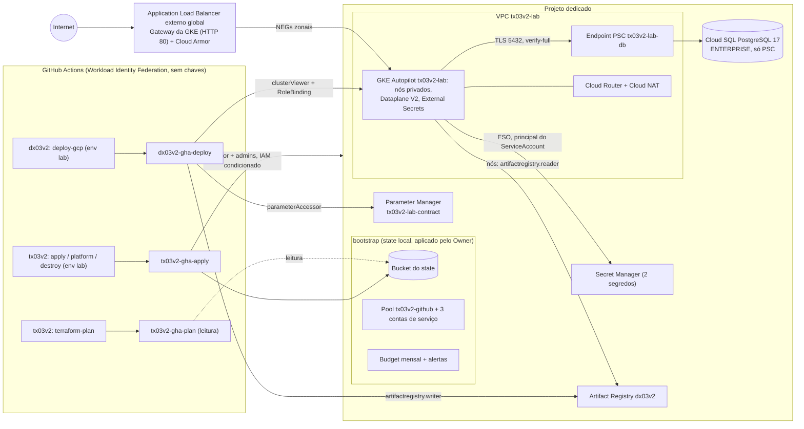
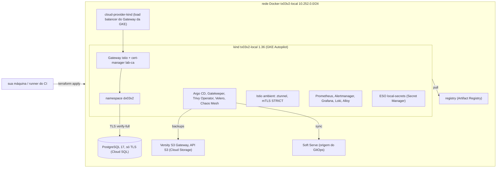

# Arquitetura do tx03v2

Visão da infraestrutura Google Cloud do lab, as decisões por trás dela (ADRs curtos), a equivalência
com os labs AWS (`tx01v2`) e Azure (`tx02v2`) e o que mudou em relação ao v1. Nada disto foi aplicado
em nuvem na v2 (`não executado em nuvem (v2)`); as decisões estão cobertas pelos testes e checks
citados.

## Diagrama

Camadas: `terraform/bootstrap` (uma vez, por um humano Owner do projeto) → `terraform/envs/lab`
(módulos `network`, `gke`, `cloudsql`, `artifact-registry`, `secrets`, `waf`, `contract`,
`project-roles`) → `platform/` (Helm e manifests, nunca pelo Terraform) → app do `dx03v2`
(`planejado`). O contrato entre as camadas está em `docs/CONTRATO.md`.

## Lab local

A mesma arquitetura emulada no Docker (`terraform/envs/local` + `platform/local`), com a plataforma
completa do v1 por cima; é o lab local do `tx01v2` com os nomes do `tx03v2` e os gêmeos Google Cloud.
Detalhes, sondas e limites: `docs/LAB_LOCAL.md` (rodada de ponta a ponta `planejado` aqui).

## Decisões (ADRs curtos)

| # | Decisão | Motivo | Alternativa descartada |
|---|---|---|---|
| 1 | GKE Autopilot em vez de Standard | sem node pools para dimensionar, cobrança por request de pod, o free tier da GKE (US$74,40/mês por conta de faturamento) cobre a taxa de um cluster Autopilot, NetworkPolicy aplicada pelo Dataplane V2 (as do dx03v2 importam); o harness recusa `google_container_node_pool` | Standard com node pool (VMs para dimensionar; o free tier não cobre um cluster Standard regional) |
| 2 | Um projeto dedicado por lab | o budget, o `scripts/leftovers.sh` e os papéis do CI têm o projeto como escopo; nada acima do projeto (o harness recusa recursos de organização e pasta); apagar o projeto é a limpeza final mais forte | projeto compartilhado com outros sistemas |
| 3 | Private Service Connect em vez de private services access | o peering do private services access não pode ser apagado depois que uma instância Cloud SQL existiu (terraform-provider-google #19908, aberto desde 2024-10, ainda relatado em 2026-07): o destroy falharia; com PSC o endpoint é um endereço interno + forwarding rule, sem peering, e só o projeto do lab é consumidor | private services access (peering /16 do v1); IP público com redes autorizadas |
| 4 | CA compartilhada (`GOOGLE_MANAGED_CAS_CA`) + nome DNS do PSC | o certificado do servidor traz o nome DNS da instância no SAN, então o dx03v2 pode usar `verify-full` com o bundle público da região, aceito só com a raiz do contrato; a zona privada `<region>.sql.goog.` resolve esse nome para o endpoint; rotação automática do certificado na manutenção | CA por instância (`GOOGLE_MANAGED_INTERNAL_CA`, a CA muda a cada instância); TLS sem verificar o servidor (v1) |
| 5 | Parameter Manager como store do contrato | um parâmetro JSON global (`tx03v2-lab-contract`) com uma versão viva `c-<sha256[0:16]>` (`create_before_destroy`); ler com `render` precisa só de `roles/parametermanager.parameterAccessor`; o provider 8.6.0 não tem IAM por parâmetro, por isso a concessão é no projeto (o projeto do lab só tem esse parâmetro) | remote state compartilhado (vaza o state inteiro); um parâmetro por chave |
| 6 | ServiceAccount do controller do ESO como principal do Workload Identity Federation for GKE | nenhuma conta de serviço do Google nem chave: `roles/secretmanager.secretAccessor` direto em cada segredo para `principal://.../subject/ns/external-secrets/sa/external-secrets`; o ClusterSecretStore não tem bloco `auth` | conta de serviço do Google com a anotação `iam.gke.io/gcp-service-account`; chave JSON em Secret |
| 7 | Endpoint DNS do plano de controle (só IAM) em vez de listas de IP | runners hospedados do GitHub e laptops não têm IP fixo; toda requisição pelo nome `*.gke.goog` passa pelo IAM (`container.clusters.connect`) e depois pelo RBAC; tokens e certificados do Kubernetes por esse endpoint ficam desligados; o endpoint IP é privado e as redes autorizadas não têm CIDR nem IPs públicos do Google Cloud (CIS GKE 5.6.3) | endpoint público aberto a `0.0.0.0/0` (o tx02v2 precisa disso, ADR 19 de lá); cluster privado com bastion ou VPN |
| 8 | Cloud Armor Standard com inspeção de 64 KB | regras pré-configuradas `sqli-v33-stable` e `xss-v33-stable` (sensibilidade 1, `deny(403)`), regra padrão `allow`, análise JSON padrão; 64 KB é o máximo; corpos maiores não são bloqueados por tamanho, então o corpo de 70 KB do smoke chega à API, que responde 413; `enable_waf = false` publica `none` | Cloud Armor Enterprise (assinatura); sem WAF (opcional, ~US$0,011/h mais barato) |
| 9 | Só o provider GA (`hashicorp/google`) | o harness recusa `google-beta`; tudo o que o lab usa existe no 8.6.0 GA (schema conferido) | google-beta (atributos que mudam sem aviso) |
| 10 | Bootstrap com state local, aplicado pelo Owner | ele liga as APIs, cria o bucket do state e as identidades do CI, coisas que o CI não pode fazer por si; um executor por root (lição 25 do v1); backup do `terraform.tfstate` ou migração opcional para o bucket | bootstrap pelo CI com uma credencial de Owner |
| 11 | Nada de providers `kubernetes`/`helm` no Terraform | o state não depende da API do cluster; o destroy não trava em objetos do Kubernetes; camadas separadas | Helm via Terraform |
| 12 | Segredos `ephemeral` + argumentos write-only (`password_wo`, `secret_data_wo`) | a senha do banco e o token de admin nunca entram no plan nem no state; o mesmo apply envia a mesma senha ao Cloud SQL e ao segredo; `db_password_version` gira os dois | `random_password` como recurso (fica no state) |
| 13 | GitHub → Google Cloud só por Workload Identity Federation, um vínculo por sujeito exato | condição do provider: dono + os dois repositórios; `roles/iam.workloadIdentityUser` por sujeito (`pull_request`, `refs/heads/main`, `environment:lab`); nenhuma chave de conta de serviço (o harness recusa `google_service_account_key` e `credentials_json`) | chave JSON em secret do GitHub; `principalSet` por repositório ou por dono (v1) |
| 14 | `roles/resourcemanager.projectIamAdmin` do apply com a condição `modifiedGrantsByRole` | `api.getAttribute('iam.googleapis.com/modifiedGrantsByRole', []).hasOnly([...])` com exatamente os 3 papéis de `modules/project-roles` (sintaxe da documentação "Delegate granting access with IAM conditions", verificada em 2026-10-11); o root do lab só concede esses (precondition + testes nos dois roots); o apply não consegue se dar Owner | projectIamAdmin sem condição (v1) |
| 15 | Papéis do apply: Editor + `container.admin`, `secretmanager.admin`, `artifactregistry.admin`, `parametermanager.admin`, `iam.serviceAccountUser`; `storage.objectUser` no bucket | o Editor cria os recursos; os admins dão o que o Editor não tem (RBAC do cluster e IAM de segredos, repositório e parâmetros); o Service Account User deixa a GKE rodar os nós como `tx03v2-lab-nodes`, concedido no projeto porque essa conta nasce no root do lab (achado `GCP-0011` do trivy, aceito) | Owner do projeto |
| 16 | Papéis do plan: Viewer, Security Reviewer e Parameter Viewer; `storage.objectViewer` no bucket; plans com `-lock=false` | o refresh lê os recursos, as políticas IAM de cada `*_iam_member` e a versão do parâmetro com o payload (`parametermanager.parameterVersions.get`, google 8.6.0); as versões de segredo usam `secret_data_wo_version`, então o refresh nunca chama `:access` e o plan não lê segredo; sem escrita no bucket, o plan não grava o objeto de lock | Editor para o plan |
| 17 | Conta de serviço dos nós `tx03v2-lab-nodes` | `roles/container.defaultNodeServiceAccount` (logs, métricas, metadados) e `artifactregistry.reader` só no repositório `dx03v2`; nunca a conta padrão do Compute Engine (que tem Editor) | conta padrão do Compute Engine |
| 18 | Gateway da GKE (controlador gerenciado) com endereço global reservado | classe `gke-l7-global-external-managed`, `spec.addresses` `NamedAddress` `tx03v2-lab-gateway`; nada a instalar nem a fixar; um único ponto de entrada (lição 3 do v1); HTTP 80 hoje, HTTPS `planejado` | Ingress + ManagedCertificate (v1); ingress-nginx |
| 19 | `platform/uninstall.sh` antes do destroy: apaga o namespace `dx03v2` e espera o finalizer do Gateway e os NEGs | o controlador cria forwarding rule, proxies, URL map, backend services, health checks e NEGs fora do state; com o cluster apagado antes, eles vazariam (lição 4 do v1); o destroy termina com `leftovers.sh --retry-for 900` | confiar só no `terraform destroy` |
| 20 | Cloud SQL PostgreSQL 17, edição ENTERPRISE, `db-g1-small`, zonal, 10 GB sem crescimento automático, 1 backup retido, sem PITR | o PostgreSQL 16+ cria Enterprise Plus por padrão e os tiers de núcleo compartilhado só existem na Enterprise (lição 12 do v1); 50 conexões cobrem 4 réplicas × pool 10 + a migração; a validação recusa `db-f1-micro` (25 conexões) e tiers da Enterprise Plus | Enterprise Plus (`db-perf-optimized-N-2`, ~US$150/mês nas notas do v1); `db-f1-micro` |
| 21 | Sufixo aleatório (`random_id` de 2 bytes) no nome da instância Cloud SQL; banco e usuário `app` com `deletion_policy = "ABANDON"` | o nome de uma instância apagada fica reservado por até uma semana; apagar um usuário dono de objetos falha no PostgreSQL, e os dois somem com a instância (issue #7677 do provider) | nome fixo (v1: instância fora do state depois de uma criação parcial) |
| 22 | Sufixo determinístico `substr(sha1(project_id), 0, 8)` no bucket do state | nome previsível, que os workflows conferem em `TF_STATE_BUCKET`, sem nada aleatório no bootstrap | sufixo aleatório |
| 23 | Bucket do state: acesso uniforme, prevenção de acesso público, versionamento, versões antigas apagadas após 30 dias, `force_destroy = false`, `deletion_policy = "PREVENT"` até `state_protection = false`, criptografia padrão do Google (sem CMEK) | o state sobrevive às rodadas; o backend GCS faz o lock com um objeto; nenhum workflow apaga state ou lock (`policy-workflows`) | `prevent_destroy` (não dá para desligar por variável); CMEK (chave no KMS com custo e IAM próprios) |
| 24 | Artifact Registry `dx03v2` com tags imutáveis, limpeza (versões sem tag com mais de 7 dias saem; as 10 mais recentes ficam) e varredura desligada | o dx03v2 publica cada SHA uma vez; o gate de vulnerabilidades é o trivy do CI dele (o Artifact Analysis cobra por imagem) | tags mutáveis como `latest` (v1) |
| 25 | Labels do contrato pelo `default_labels` do provider em cada root, com `add_terraform_attribution_label = false` | todo recurso que aceita labels recebe exatamente os quatro (`policy-labels`); módulos não configuram provider | `labels` repetido em cada recurso |
| 26 | Private Google Access + Cloud NAT `AUTO_ONLY` só para a subnet dos nós, logs só de erros | os nós privados alcançam as APIs do Google sem NAT e o resto da Internet pelo NAT; logs são cobrados por GB | nós com IP público |
| 27 | Logs da GKE `SYSTEM_COMPONENTS` + `WORKLOADS`, sem stack de observabilidade no cluster | a franquia de 50 GiB por projeto do Cloud Logging cobre um lab; Prometheus, Grafana, Istio e ArgoCD custavam mais que o app no v1 (lição 5) | kube-prometheus-stack |
| 28 | Budget no bootstrap, sem `currency_code` | o valor fica na moeda da conta de faturamento; alertas de 50/90/100 % do gasto e 100 % da previsão para os administradores da conta e os e-mails opcionais; o budget só avisa | budget só em documentação (v1) |
| 29 | `deletion_protection = false` no cluster e na instância | toda rodada termina com destroy; os dados do lab são descartáveis | proteção ligada (o destroy exigiria um apply antes) |
| 30 | Lab local com Terraform + provider Docker e kind por CLI (`terraform_data` + `local-exec`) | o mesmo fluxo apply/destroy da nuvem, sem conta; o provider `tehcyx/kind` embute uma versão antiga do kind; o state local guarda credenciais descartáveis desta máquina (`random_password` e backend `local` só em `terraform/envs/local`) | emuladores do Google Cloud (os emuladores do gcloud cobrem Pub/Sub, Datastore, Firestore, Bigtable e Spanner; nada para GKE, Cloud SQL ou Secret Manager); minikube |
| 31 | Istio ambient no lab local | mTLS e autorização por identidade sem sidecar; roda no kind (no v1 o Autopilot recusou o `NET_ADMIN` do sidecar e do ztunnel, lição 7) | sidecar (mais memória por pod); Linkerd |
| 32 | GitOps com Argo CD lendo um servidor git do lab | um único dono do namespace do app; o push usa a chave do state, a leitura é anônima; o Argo CD fica só ClusterIP | Flux; apontar para o GitHub (exigiria credenciais e internet no caminho do deploy) |
| 33 | Gatekeeper com políticas próprias testadas no `gator` | as regras do v1 (tx01 e o `:latest` do tx03), em `deny`, com casos que provam aceitação e recusa | gatekeeper-library inteira (mais regras do que o lab explica); Policy Controller da GKE (não avaliado); Kyverno |
| 34 | Alertmanager → `alert-sink` dentro do cluster | entrega de alerta provada sem credencial externa | Slack/e-mail reais |
| 35 | Velero no emulador de objetos (API S3), backup por recursos, sem snapshots | o ensaio de restore roda em minutos e sem nuvem (o v1 nunca restaurou nada, lição 17); o emulador fala S3, então o plugin AWS do Velero só existe no lab local (no Google Cloud seria o plugin GCP num bucket do Cloud Storage, `planejado`) | `pg_dump` sozinho; snapshots CSI; um emulador da API do Cloud Storage (não avaliado; o lab reaproveita o emulador do `tx01v2`) |
| 36 | Perfis `core`/`observability`/`operations`/`full`; rede `10.252.0.0/24` e registry em `localhost:5003` | máquinas com pouca memória validam uma camada por vez; o CI roda `full`; rede e porta diferentes das do `tx01v2` (`10.250.0.0/24`, `5001`) e do `tx02v2` (`10.251.0.0/24`, `5002`) evitam colisão entre os labs | um único perfil; os mesmos endereços em todos os pares |

### O que fica fora do state

O controlador de Gateway da GKE cria o load balancer do app a partir dos objetos do dx03v2: forwarding
rule (no endereço `tx03v2-lab-gateway`), target proxy, URL map, backend services, health checks e
NEGs `k8s1-*`. Nada disso está no state do Terraform. Se o cluster sumir antes do Gateway, essas
peças ficam órfãs e algumas continuam cobrando. Por isso o destroy (workflow e runbook) roda
`platform/uninstall.sh` enquanto o cluster existe e termina com `scripts/leftovers.sh`, que lista
cada tipo dessas peças.

### Nomes que ficam presos

- Instância Cloud SQL: o nome de uma instância apagada fica reservado por até uma semana. O sufixo
  aleatório (ADR 21) evita o conflito na rodada seguinte.
- Pool de Workload Identity Federation: um pool apagado fica em soft delete por 30 dias e o ID não
  pode ser reutilizado nesse tempo. Um novo bootstrap no mesmo projeto, depois de um teardown,
  falha no pool `tx03v2-github`: recupere-o (`gcloud iam workload-identity-pools undelete
  tx03v2-github --location=global`) e importe-o no state, ou use outro projeto (não verificado em
  nuvem).
- Bucket do state: o nome deriva do ID do projeto (ADR 22); no mesmo projeto ele é sempre o mesmo.

### Quem pode o quê no projeto

O Owner do projeto tem as permissões de dados do Google Cloud (objetos do bucket, segredos,
parâmetros) e o acesso de administrador ao cluster pelo IAM, então um apply local como Owner não
precisa de papéis extras. O budget é diferente: ele vive na conta de faturamento e exige um papel
nela (Billing Account Administrator ou Costs Manager). As contas do CI nunca recebem papéis na conta
de faturamento.

## AWS (tx01v2) / Azure (tx02v2) ↔ Google Cloud (tx03v2)

| Tema | tx01v2 (AWS) | tx02v2 (Azure) | tx03v2 (Google Cloud) |
|---|---|---|---|
| Bootstrap | bucket S3 (lock nativo), provider OIDC, 3 papéis, budget | conta de storage (lease de blob), registro de providers, grupo do lab, 3 managed identities federadas, budget | 15 APIs, bucket GCS (lock por objeto), pool e provider do Workload Identity Federation, 3 contas de serviço, budget do projeto |
| Identidade do CI | papéis IAM com `sub` exato | managed identities com um sujeito exato por credencial federada | contas de serviço com um `workloadIdentityUser` por sujeito exato |
| Limite do apply | papel quase administrador da conta; permission boundary `planejado` | Contributor + papéis de dados só em `tx02v2-lab`; atribuição de papéis limitada por ABAC | Editor + papéis de admin no projeto; concessões de projeto limitadas pela condição `modifiedGrantsByRole` |
| Cluster | EKS 1.36, access entries, Pod Identity, add-ons gerenciados | AKS 1.36 Free, Entra ID + Azure RBAC, Workload ID, contas locais desligadas | GKE Autopilot no canal REGULAR (1.36), endpoint DNS só com IAM, Workload Identity Federation for GKE |
| Nós | AL2023 SPOT t3.medium/t3a.medium | Azure Linux, `Standard_D2als_v6` | gerenciados pelo Autopilot (cobrança por request de pod) |
| Rede | VPC com subnets públicas/privadas, 1 NAT gateway | VNet com subnets delegadas, CNI Overlay + Cilium, saída pelo Load Balancer do AKS | VPC custom, nós privados, Private Google Access, Cloud NAT, Dataplane V2 |
| Entrada | ALB do Load Balancer Controller (Ingress) + web ACL do WAF | Application Gateway for Containers (Gateway API) + política de WAF DRS 2.1 | Gateway da GKE (Application Load Balancer externo global) + Cloud Armor |
| Banco | RDS PostgreSQL 17, `rds.force_ssl` | PostgreSQL Flexible Server 17 privado, `require_secure_transport = on` | Cloud SQL PostgreSQL 17 ENTERPRISE, só PSC, CA compartilhada (`verify-full`) |
| Segredos | Secrets Manager + KMS, ESO por Pod Identity | Key Vault (RBAC), ESO por Workload ID | Secret Manager, ESO com o próprio ServiceAccount como principal |
| Registry | ECR com tags imutáveis | ACR Basic (sem imutabilidade: o deploy recusa sobrescrever tags) | Artifact Registry com tags imutáveis |
| Contrato | SSM Parameter Store `/tx01v2/lab/*` | App Configuration `tx02v2/lab/*` | Parameter Manager `tx03v2-lab-contract` (um JSON com 15 chaves) |
| Tags/labels | `default_tags` do provider | `local.tags` em cada recurso (check `policy-tags`) | `default_labels` do provider (check `policy-labels`) |
| Criptografia | chave KMS do lab | chaves da plataforma (sem CMEK) | chaves do Google (sem CMEK) |
| Maior custo | plano de controle do EKS + NAT | AGC com WAF | taxa do cluster GKE (quando o free tier já é usado), Cloud SQL, load balancer |

## v1 → v2

| Problema no v1 (tx03/dx03) | Decisão no v2 | Evidência |
|---|---|---|
| O `ci.yml` só listava arquivos com `ls` e imprimia "Repository is valid!" | harness com 38 checks (com o lab local), `HARNESS_STRICT=1` (zero SKIP) e `terraform test` com provider mockado | `make verify`, `docs/HARNESS.md` |
| O `terraform-plan.yml` escutava PRs em `main`, mas o branch padrão era `master`: nenhum PR teve plan | branch `main` com ruleset versionado; o sujeito do plan cobre `pull_request` e `refs/heads/main` | `.github/rulesets/main.json`, `identities.tftest.hcl` |
| Lock do state apagado (`gsutil rm .../default.tflock`) com `continue-on-error` antes de todo apply | nenhum passo apaga lock; plan com `-lock=false` e só leitura no bucket; `force-unlock` é decisão manual | `policy-workflows` (recusa `gsutil rm`, `gcloud storage rm`, `force-unlock`, `continue-on-error`) |
| Pool e provider de Workload Identity Federation criados à mão, com condição aberta ao dono inteiro e `principalSet` por repositório | pool `tx03v2-github` no bootstrap, condição dono + 2 repositórios, um vínculo por sujeito exato | `identities.tftest.hcl`; `policy-terraform` (recusa `principalSet://`) |
| Uma conta de serviço para tudo, com papéis crescendo por tentativa até `projectIamAdmin` sem condição | três contas por função; `projectIamAdmin` do apply limitado pela condição `modifiedGrantsByRole` à lista do root | `roles.tftest.hcl` nos dois roots |
| Endpoint público do GKE sem redes autorizadas; tfvars de exemplo com variáveis que o código ignorava | nós privados, endpoint IP desligado, redes autorizadas fechadas, endpoint DNS só com IAM | `gke.tftest.hcl`, `policy-terraform` |
| README afirmava mTLS com o Istio em `PERMISSIVE` e sem sidecars | sem malha de serviço na v2; matriz de status com rótulos exatos | `repo-structure`, `README.md` |
| Módulo de budget nunca chamado pelo root (e inválido) | `google_billing_budget` no bootstrap, coberto por teste | `budget.tftest.hcl` |
| PostgreSQL 16 sem `edition` (cria Enterprise Plus) com `db-g1-small`: `Invalid Tier ... for (ENTERPRISE_PLUS) Edition` | PostgreSQL 17 com `edition = "ENTERPRISE"`; a validação recusa `db-f1-micro` e tiers da Enterprise Plus | `data_stores.tftest.hcl`, `validations.tftest.hcl` |
| `destroy.yml` com aspas não fechadas, escondidas pelo `continue-on-error` | lógica em `scripts/` e `platform/` com shellcheck; destroy com confirmação digitada, uninstall, destroy e leftovers, sem engolir erros | `shellcheck`, `actionlint`, `policy-workflows` |
| Recursos criados pelo Kubernetes (forwarding rules, backend services, certificados, regras de firewall, discos) sobravam depois do destroy | `platform/uninstall.sh` espera o finalizer do Gateway e os NEGs; `leftovers.sh --retry-for 900` | `terraform-destroy.yml`, `policy-workflows` |
| Senha do banco em documentos e em secrets do GitHub; senha com símbolos quebrando o pipeline | senha efêmera alfanumérica, write-only no Cloud SQL e no Secret Manager; o ESO entrega ao pod | `policy-terraform`, `data_stores.tftest.hcl` |
| App: `npm ci` com `ERESOLVE`, `NODE_ENV: "dev"` derrubando o backend, probe com `METRICS_TOKEN_PLACEHOLDER`, UI lendo campos removidos de `/health` | o dx03v2 roda o mesmo app do dx02v2, com `APP_ENV=lab` e health checks `/readyz`/`/healthz` sem segredo | CI do dx03v2 (`static`, `test`, `images`, `e2e`); `docs/CONTRATO.md` |
| Identificadores e senhas do projeto em notas Markdown | só placeholders, verificado por máquina | `policy-identifiers`, `gitleaks` |

As lições completas, com o que aconteceu, a lição e o que a v2 faz: `docs/LICOES_APRENDIDAS.md`.
